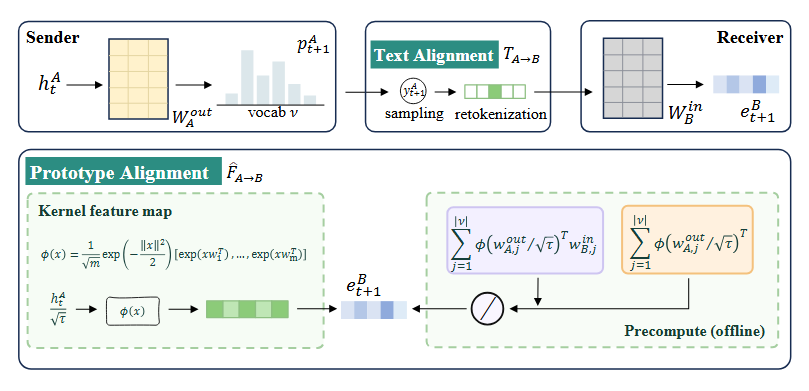
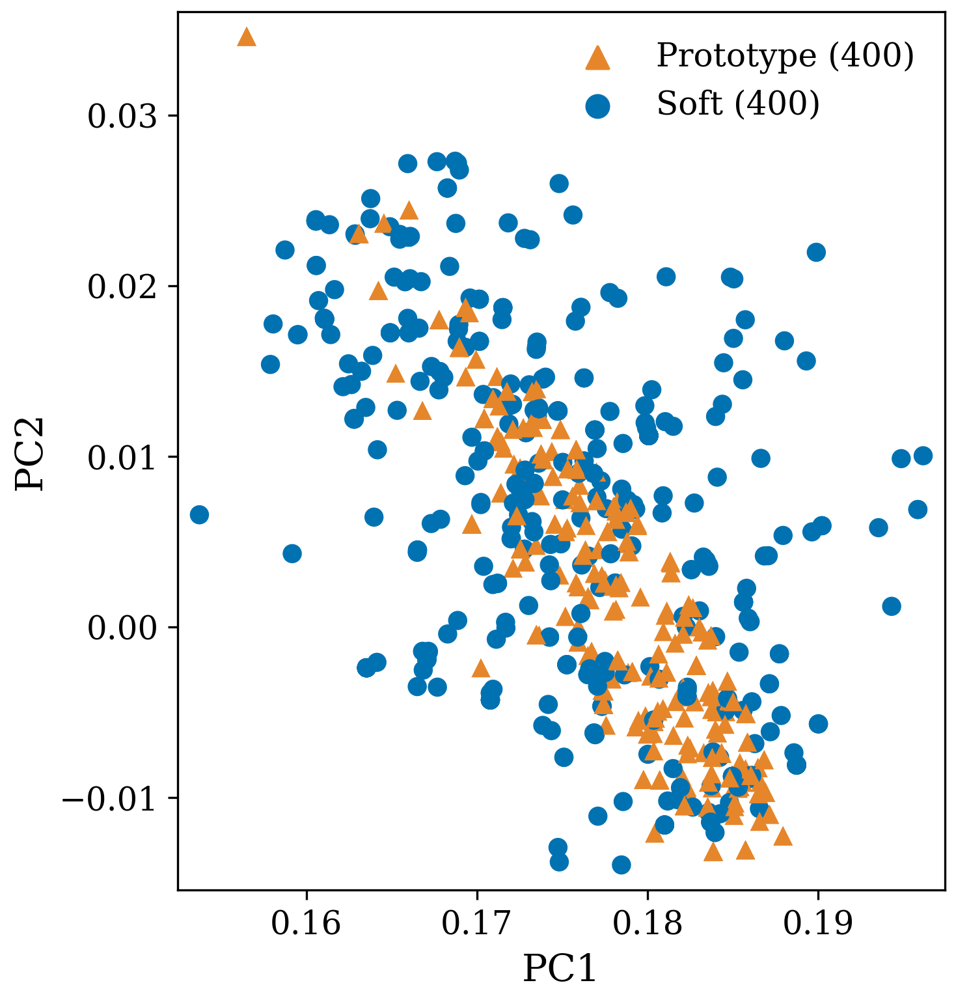
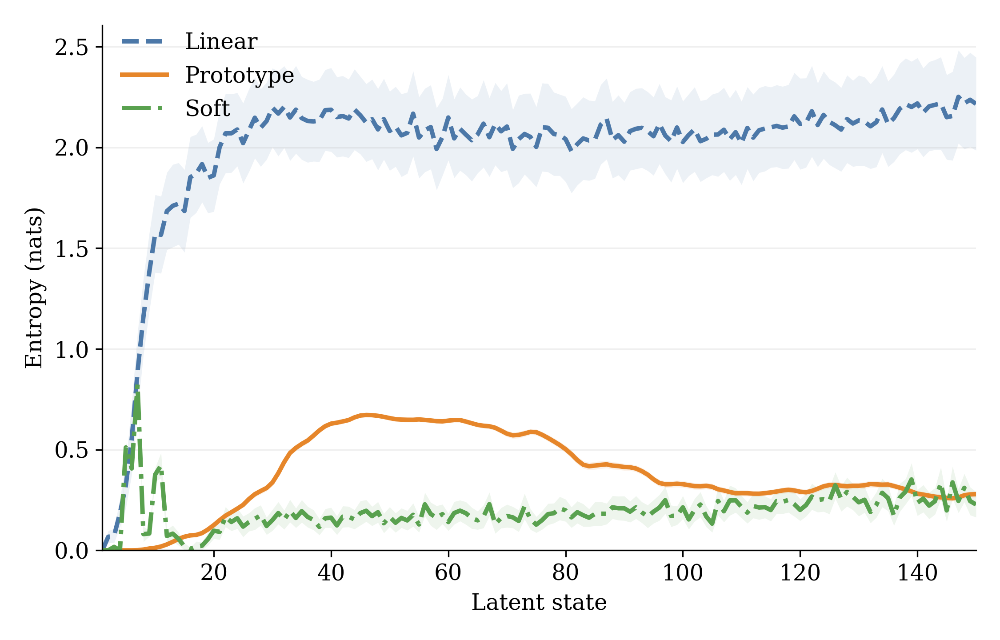
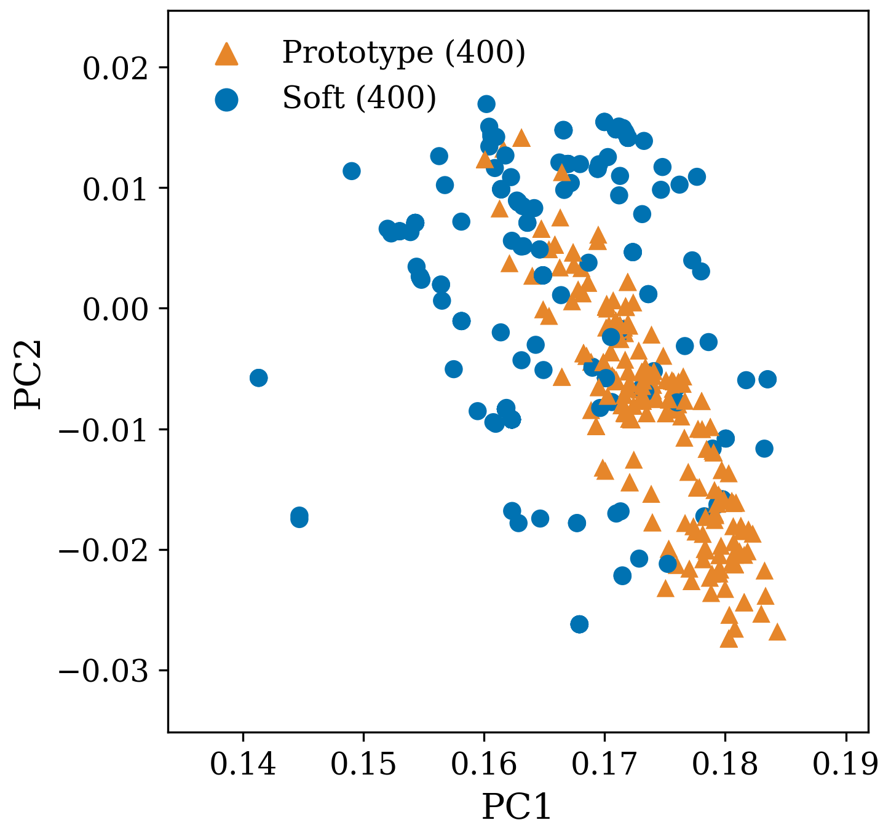
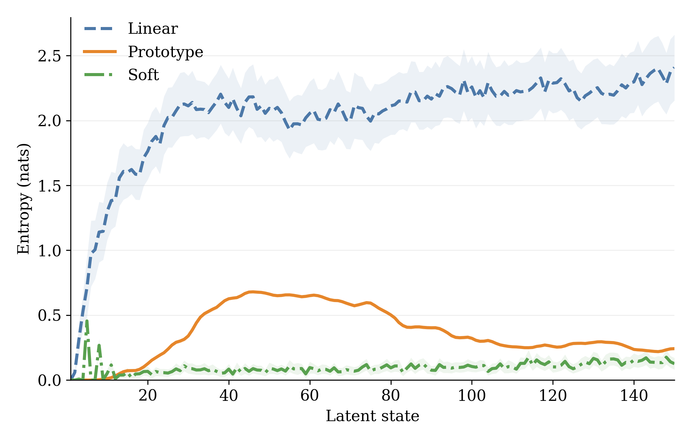
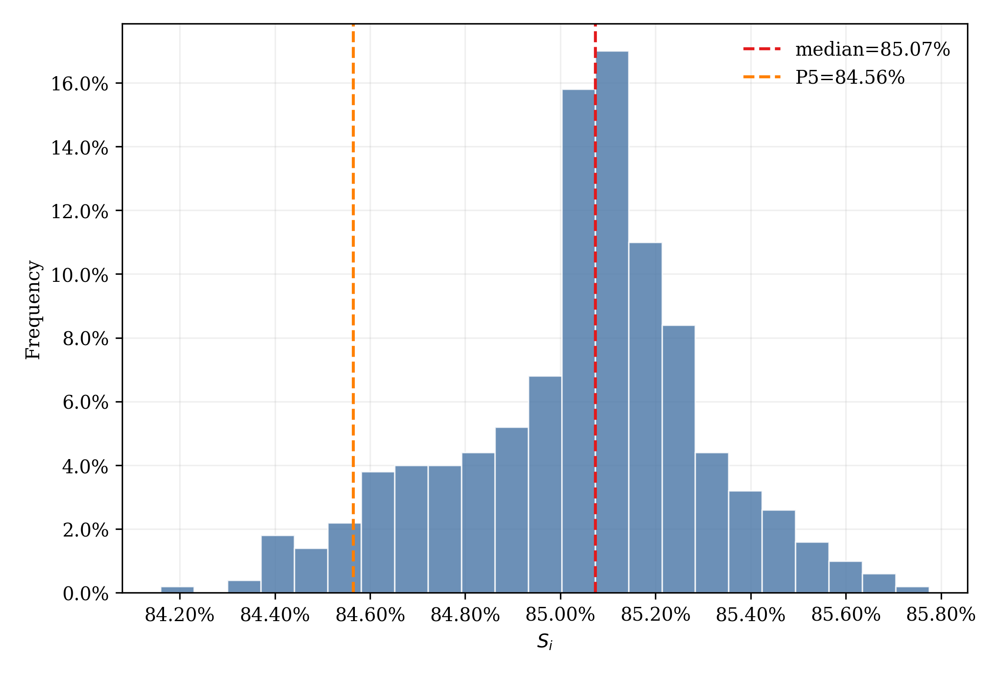

<p align="center">
  <a href="assets/model.png">
    
  </a>
</p>

<h1 align="center">Prototype-Based Latent Alignment for Multi-Agent Systems</h1>

<p align="center">
  <strong>A Training-free Latent Alignment for Latent Reasoning and Cross-Model Communication.</strong>
</p>

<p align="center">
  <a href="#overview">Overview</a> &middot;
  <a href="#method">Method</a> &middot;
  <a href="#results">Results</a> &middot;
  <a href="#analysis">Analysis</a> &middot;
  <a href="#installation">Installation</a> &middot;
  <a href="#quick-start">Quick start</a> &middot;
  <a href="#reproduction">Reproduction</a>
</p>

---

## Overview

Prototype Align transfers a sender model's final-layer hidden states into a receiver model's input-embedding space without decoding intermediate text and without training an adapter. This repository supports continuous reasoning within a Qwen3 checkpoint and latent communication between tokenizer-compatible Qwen3 checkpoints.

Prototype Align constructs a compact set of vocabulary-derived prototypes in the receiver's embedding space. Orthogonal random probes define weighted averages of receiver embeddings using the sender's unembedding vectors; the current hidden state determines a nonlinear mixture of these cached prototypes. This requires no adapter training. The equivalent positive random-feature implementation operates over the prototypes rather than the full vocabulary during online alignment.

| Property | Prototype Align |
|:--|:--|
| Training | None |
| Intermediate medium | Continuous hidden states |
| Offline computation | Vocabulary-derived prototypes and normalization masses |
| Online alignment cost | $O(m(d_A+d_B))$, with $m \ll |\mathcal V|$ |
| Homogeneous agents | Supported |
| Heterogeneous agents | Tokenizer-compatible Qwen3 checkpoints; hidden dimensions may differ |
| Architectures | Sequential and hierarchical |
| Supported models | Qwen3-8B and Qwen3-14B |

The primary evaluation covers AIME 2024, AIME 2025, HumanEval+, MBPP+, GPQA-Diamond, and MedQA. GSM8K, ARC-Easy, and ARC-Challenge are supplementary benchmarks.

<a id="method"></a>
<details>
<summary><strong>Method</strong></summary>

<br>

For sender $A$ and receiver $B$, let $q=h^A/\sqrt\tau$, $k_j=w^{out}_{A,j}/\sqrt\tau$, and $v_j=w^{in}_{B,j}$. Sample $m$ Gaussian probes $\omega_i$ with orthogonality within each ORF block. Each probe defines a receiver-space prototype and its vocabulary mass:

$$
b_{ij}=\exp\!\left(\omega_i^\top k_j-\frac{\|k_j\|^2}{2}\right),\qquad
Z_i=\sum_j b_{ij},\qquad
u_i=\frac{\sum_j b_{ij}v_j}{Z_i}.
$$

The hidden state determines positive activations and normalized mixing weights:

$$
a_i(q)=\exp(\omega_i^\top q)Z_i,\qquad
\alpha_i(q)=\frac{a_i(q)}{\sum_\ell a_\ell(q)},\qquad
\widehat F_{A\rightarrow B}(h^A)=\sum_i\alpha_i(q)u_i.
$$

This nonlinear mixture lies in the convex hull of the prototypes. The prototypes and masses depend only on pretrained vocabulary parameters, temperature, and sampled directions, so they can be cached for each sender–receiver pair. Online alignment costs $O(m(d_A+d_B))$ instead of $O(|\mathcal V|(d_A+d_B))$.

The construction is equivalent to normalized positive random-feature attention and approximates the readout–embedding mapping $F(h^A)=\sum_j\operatorname{softmax}(q^\top k_j)v_j$. For a fixed query and finite vocabulary, the estimator converges in probability as the number of probes increases. Closer approximation does not by itself guarantee higher downstream accuracy.

In [the implementation](src/alignment.py), cached numerator columns and denominator entries encode unnormalized prototype sums and masses. Their ratio gives each prototype, and the soft gate mixes them with query-dependent weights.

- **Intra-agent reasoning:** map the hidden state into the same model's embedding space for the next continuous reasoning step.
- **Inter-agent communication:** map a sequence of sender states into a receiver's embedding space.

Cross-model execution verifies identical token-to-ID mappings. Sender and receiver hidden dimensions may differ.

</details>

<a id="results"></a>
<details>
<summary><strong>Results</strong></summary>

<br>

Reference results use the sequential configuration. Accuracy is a percentage (pass@1 for code generation), and averages are unweighted across the listed benchmarks. Full results include means and population standard deviations; the tables here show means. Text and homogeneous Linear Align are published LatentMAS results.

### Homogeneous collaboration

#### Qwen3-8B

| Benchmark | Text | Linear | Exact-soft (fixed) | Filtered-soft (fixed) | Prototype (fixed) | Exact-soft (entropy) | Filtered-soft (entropy) | Prototype (entropy) |
|:--|--:|--:|--:|--:|--:|--:|--:|--:|
| AIME 2024 | 53.30 | 56.70 | 53.33 | 53.33 | 68.89 | 62.22 | 72.22 | 65.56 |
| AIME 2025 | 53.30 | 53.30 | 40.00 | 48.89 | 54.44 | 52.22 | 43.33 | 57.78 |
| HumanEval+ | 80.50 | 80.50 | 77.44 | 78.66 | 83.94 | 83.13 | 84.15 | 83.94 |
| MBPP+ | 69.50 | 74.60 | 73.02 | 71.78 | 75.40 | 72.49 | 74.69 | 75.49 |
| GPQA-Diamond | 43.40 | 45.50 | 45.12 | 46.63 | 49.16 | 48.48 | 41.58 | 50.17 |
| MedQA | 75.00 | 75.30 | 71.33 | 70.33 | 73.22 | 68.67 | 68.22 | 73.22 |
| AVG | 62.50 | 64.32 | 60.04 | 61.60 | 67.51 | 64.54 | 64.03 | 67.69 |

#### Qwen3-14B

| Benchmark | Text | Linear | Exact-soft (fixed) | Filtered-soft (fixed) | Prototype (fixed) | Exact-soft (entropy) | Filtered-soft (entropy) | Prototype (entropy) |
|:--|--:|--:|--:|--:|--:|--:|--:|--:|
| AIME 2024 | 63.30 | 66.70 | 70.00 | 68.89 | 75.56 | 68.89 | 65.56 | 73.33 |
| AIME 2025 | 60.00 | 63.30 | 57.78 | 55.56 | 60.00 | 54.44 | 53.33 | 58.89 |
| HumanEval+ | 81.10 | 86.50 | 88.82 | 87.80 | 88.21 | 91.26 | 88.41 | 84.55 |
| MBPP+ | 72.80 | 75.70 | 77.87 | 77.69 | 78.13 | 79.98 | 79.54 | 78.22 |
| GPQA-Diamond | 51.50 | 52.00 | 54.55 | 55.89 | 56.23 | 52.53 | 53.70 | 54.71 |
| MedQA | 80.30 | 80.70 | 78.44 | 78.78 | 80.67 | 78.11 | 78.33 | 79.22 |
| AVG | 68.17 | 70.82 | 71.24 | 70.77 | 73.13 | 70.87 | 69.81 | 71.49 |

On Qwen3-8B, Prototype Align improves average accuracy over the strongest baseline by **3.19 percentage points with fixed budgets** and **3.15 with entropy stopping**. On Qwen3-14B, the corresponding gains over Exact-Soft Align are 1.89 and 0.62 points.

For Qwen3-8B, average end-to-end time under entropy stopping is 95.8 seconds per problem for Prototype Align, versus 297.3 for Exact-Soft Align and 222.4 for Filtered-Soft Align. With fixed budgets, the corresponding times are 101.4, 90.9, and 90.5 seconds: Prototype Align provides higher accuracy while taking slightly longer. Alignment alone takes 0.255 ms per step for Prototype Align versus 1.541 ms for Exact-Soft Align.

### Heterogeneous collaboration

These experiments use a two-agent Planner → Judger system.

#### Qwen3-8B → Qwen3-14B

| Benchmark | Text | Linear | Exact-soft (fixed) | Filtered-soft (fixed) | Prototype (fixed) | Exact-soft (entropy) | Filtered-soft (entropy) | Prototype (entropy) |
|:--|--:|--:|--:|--:|--:|--:|--:|--:|
| AIME 2025 | 60.00 | 66.67 | 61.11 | 68.89 | 70.00 | 58.89 | 57.78 | 56.67 |
| MBPP+ | 78.84 | 74.34 | 78.31 | 77.51 | 76.19 | 75.95 | 82.01 | 72.31 |
| MedQA | 78.11 | 81.33 | 81.11 | 81.56 | 82.00 | 78.67 | 78.89 | 80.89 |
| AVG | 72.32 | 74.11 | 73.51 | 75.99 | 76.06 | 71.17 | 72.89 | 69.96 |

#### Qwen3-14B → Qwen3-8B

| Benchmark | Text | Linear | Exact-soft (fixed) | Filtered-soft (fixed) | Prototype (fixed) | Exact-soft (entropy) | Filtered-soft (entropy) | Prototype (entropy) |
|:--|--:|--:|--:|--:|--:|--:|--:|--:|
| AIME 2025 | 58.89 | 63.33 | 58.89 | 60.00 | 61.11 | 53.33 | 57.78 | 40.00 |
| MBPP+ | 82.01 | 21.34 | 76.98 | 76.54 | 72.49 | 71.78 | 80.51 | 67.90 |
| MedQA | 80.67 | 77.00 | 77.00 | 78.33 | 78.11 | 75.89 | 80.89 | 69.67 |
| AVG | 73.86 | 53.89 | 70.96 | 71.63 | 70.57 | 67.00 | 73.06 | 59.19 |

Prototype Align's fixed-budget averages are 76.06% and 70.57% in the two directions, versus 69.96% and 59.19% under entropy stopping. Text or other latent alignment methods perform better in some heterogeneous settings, and a larger sender does not necessarily overcome the limitations of a smaller receiver.

</details>

<a id="analysis"></a>
<details>
<summary><strong>Analysis</strong></summary>

<br>

### MedQA

The joint PCA projection compares representations produced by Prototype Align and exact soft alignment.

<p align="center"></p>

The entropy trajectory shows how the next-token distribution evolves over continuous latent states for linear, prototype, and soft alignment.

<p align="center"></p>

### HumanEval+

The same joint PCA analysis is applied to aligned representations collected on HumanEval+.

<p align="center"></p>

The latent-state entropy trajectory provides a complementary view of reasoning dynamics on code generation.

<p align="center"></p>

### ORF-seed stability

The ORF sensitivity study uses 500 Qwen3-8B hidden states from MedQA and 50 independently seeded ORF maps per state, with $m=1024$ and $\tau=0.6$. The seed-similarity score $S_i=1-D_i$ has a 5th percentile of 84.56% and a median of 85.07%, indicating limited variation across ORF seeds.

<p align="center"></p>

</details>

## Installation

### Requirements

- Python 3.9 or newer
- PyTorch compatible with the local CPU/CUDA environment
- Sufficient memory for the selected Qwen3 checkpoint

Create an isolated environment and install PyTorch first:

```bash
python -m venv .venv
source .venv/bin/activate
python -m pip install --upgrade pip
python -m pip install torch
python -m pip install -r requirements.txt
```

On Windows PowerShell, activate the environment with:

```powershell
.\.venv\Scripts\Activate.ps1
```

`vLLM` is optional and is used only when `--use_vllm` is selected. Install a build compatible with the local CUDA and PyTorch versions. Qwen3 checkpoints and non-local datasets are downloaded from Hugging Face on demand; standard variables such as `HF_HOME`, `HF_HUB_CACHE`, and `HF_DATASETS_CACHE` may be used to select cache locations.

## Quick start

The following command evaluates Prototype Align on the fixed local MedQA development subset:

```bash
python run.py \
  --method latent_mas \
  --align_method prototype \
  --model_name Qwen/Qwen3-8B \
  --task medqa \
  --split dev \
  --prompt sequential \
  --latent_steps 20 \
  --fixed_latent_budget \
  --prototype_features 1024 \
  --prototype_temperature 0.6 \
  --prototype_seed 42 \
  --max_samples 5
```

Reference alignment settings are:

| Parameter | Value |
|:--|--:|
| ORF dimension $m$ | `1024` |
| Alignment temperature | `0.6` |
| Exact-soft temperature | `0.6` |
| Linear ridge coefficient | `1e-5` |
| Generation top-$p$ | `0.95` |

Task-specific token limits, generation batch sizes, and latent-step budgets are defined in [`params_dict.json`](params_dict.json).

### Cross-model communication

Two model entries select the Planner &rarr; Judger configuration. Their order is sender then receiver:

```bash
python run.py \
  --method latent_mas_hybrid \
  --align_method prototype \
  --model_name Qwen/Qwen3-8B \
  --agent_models Qwen/Qwen3-8B Qwen/Qwen3-14B \
  --task gpqa \
  --split dev \
  --prompt sequential \
  --latent_steps 20 \
  --prototype_features 1024 \
  --prototype_temperature 0.6 \
  --max_samples 5
```

Two entries map to Planner/Judger. Four entries map to Planner/Critic/Refiner/Judger. Cross-model latent execution uses the Hugging Face backend.

### Baselines and ablations

| Experiment | Arguments |
|:--|:--|
| Single-agent baseline | `--method baseline` |
| Text communication | `--method text_mas` |
| Identity alignment | `--method latent_mas --align_method identical` |
| Linear alignment | `--method latent_mas --align_method linear` |
| Filtered-soft alignment | `--method latent_mas --align_method soft` |
| Exact-soft alignment (Qwen3 vocabulary) | `--method latent_mas --align_method soft --soft_top_k 1000000 --soft_top_p 1 --soft_min_p 0 --soft_max_topk 1000000` |
| Prototype Align | `--method latent_mas --align_method prototype` |
| Entropy-stopped Prototype Align | `--method latent_mas --align_method prototype_early_stopping` |

The main reference evaluation uses fixed latent-step budgets selected on a development set; pass `--fixed_latent_budget` to force exactly `--latent_steps` steps. The `prototype_early_stopping` variant instead checks entropy every 10 steps and stops after two consecutive checks below `0.25`, with a maximum of 200 latent steps per intermediate agent.

The `soft` path applies top-k, top-p, min-p, and a final support cap by default. The Exact-soft command above disables filtering by using support limits larger than the Qwen3 vocabulary. Add `--fixed_latent_budget` for fixed-step comparisons; otherwise the soft path uses entropy stopping.

New runs use `prototype` / `prototype_early_stopping` and `--prototype_*` options. Legacy `kernel` / `kernel_early_stopping` and `--kernel_*` options remain accepted and are normalized to Prototype names in logs and result metadata. The launcher uses `PROTOTYPE_*` environment variables, with `KERNEL_*` fallbacks.

Run `python run.py --help` for the complete command-line interface.

## Tasks and evaluation

| Domain | Tasks | Metric |
|:--|:--|:--|
| Mathematical reasoning | AIME 2024, AIME 2025, GSM8K | Exact-match accuracy |
| Code generation | HumanEval+, MBPP+ | pass@1 |
| Scientific and medical QA | ARC-Easy, ARC-Challenge, GPQA-Diamond, MedQA | Answer-choice accuracy |

Use `--split dev` to load the fixed local samples under `data/dev/`. Other supported splits use the loaders in [`src/data.py`](src/data.py).

By default:

- JSON summaries are written to `result/`;
- detailed per-problem traces are written to `logging/`;
- `--result_path` and `--log_path` select exact destinations;
- `--no_write_result` disables the standalone JSON summary.

## Reproduction

The reference homogeneous experiments use sequential Planner &rarr; Critic &rarr; Refiner &rarr; Judger collaboration and a hierarchical specialist configuration.

`run.sh` is a generic Bash launcher with no scheduler or machine-specific dependency. By default, it runs the baseline, TextMAS, and all homogeneous latent-alignment variants for Qwen3-8B on HumanEval+:

```bash
bash run.sh
```

Select one homogeneous configuration through environment variables:

```bash
SINGLE_CONFIG=true \
CONFIG_METHOD=latent_mas \
CONFIG_PROMPT=sequential \
CONFIG_ALIGNMENT=prototype \
MODEL_NAME=Qwen/Qwen3-8B \
TASK=medqa \
MAX_SAMPLES=-1 \
bash run.sh
```

For cross-model communication, select `latent_mas_hybrid` and provide the ordered sender and receiver checkpoints through `AGENT_MODELS`:

```bash
SINGLE_CONFIG=true \
CONFIG_METHOD=latent_mas_hybrid \
CONFIG_PROMPT=sequential \
CONFIG_ALIGNMENT=prototype \
MODEL_NAME=Qwen/Qwen3-8B \
AGENT_MODELS="Qwen/Qwen3-8B Qwen/Qwen3-14B" \
TASK=medqa \
MAX_SAMPLES=-1 \
bash run.sh
```

Runtime settings remain environment-driven. For example:

```bash
CUDA_VISIBLE_DEVICES=0 MAX_SAMPLES=5 TIMES=1 bash run.sh
PYTHON_BIN=python VENV_PATH=/path/to/venv bash run.sh
```

`run.sh` uses `.venv` automatically when present. `PYTHON_BIN`, `VENV_PATH`, `RESULT_ROOT`, `LOG_ROOT`, and `STATE_FILE` may be overridden. GPU allocation, parallelism, and process supervision are intentionally delegated to the calling environment.

## Repository layout

```text
.
|-- run.py                    # Experiment entry point
|-- run.sh                    # Generic Bash experiment launcher
|-- src/
|   |-- alignment.py          # Alignment operators
|   |-- data.py               # Dataset loaders
|   |-- models.py             # Model wrapper and latent rollout
|   |-- prompts.py            # Prompt construction
|   |-- reasoning_models.py   # Model-aware reasoning cues
|   |-- utils.py              # Runtime helpers and aggregation CLI
|   `-- methods/
|       |-- baseline.py
|       |-- text_mas.py
|       |-- latent_mas.py
|       `-- latent_mas_hybrid.py
|-- data/dev/                 # Fixed local development samples
|-- assets/                   # README and analysis visuals
|-- params_dict.json          # Task-specific experiment settings
`-- requirements.txt
```

## License

Distributed under the terms in [`LICENSE`](LICENSE).
